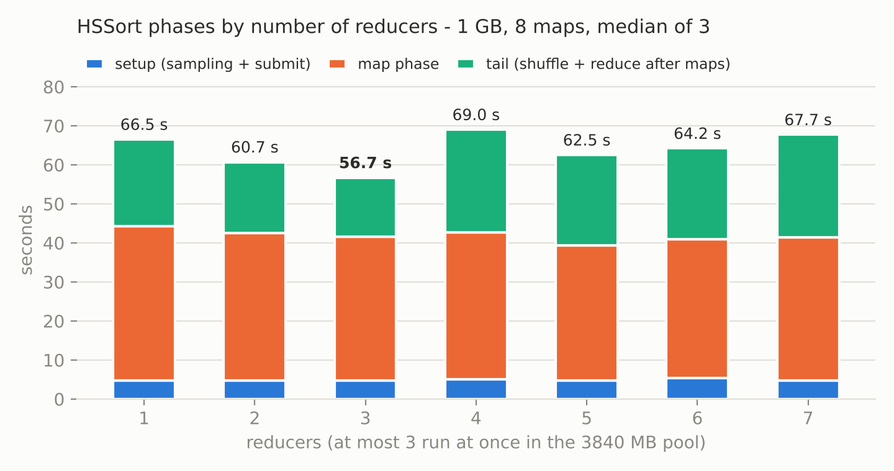
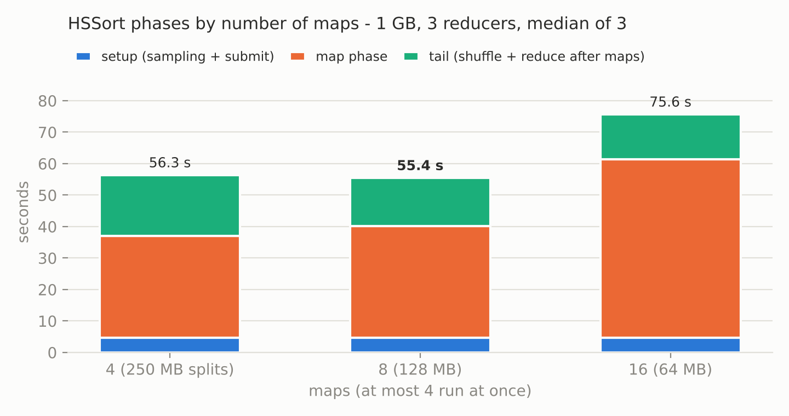
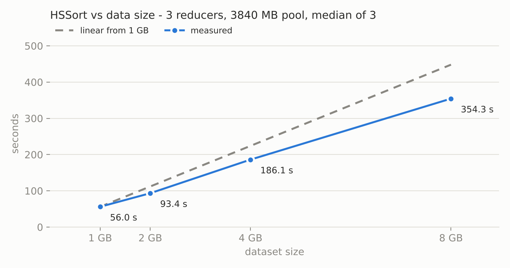
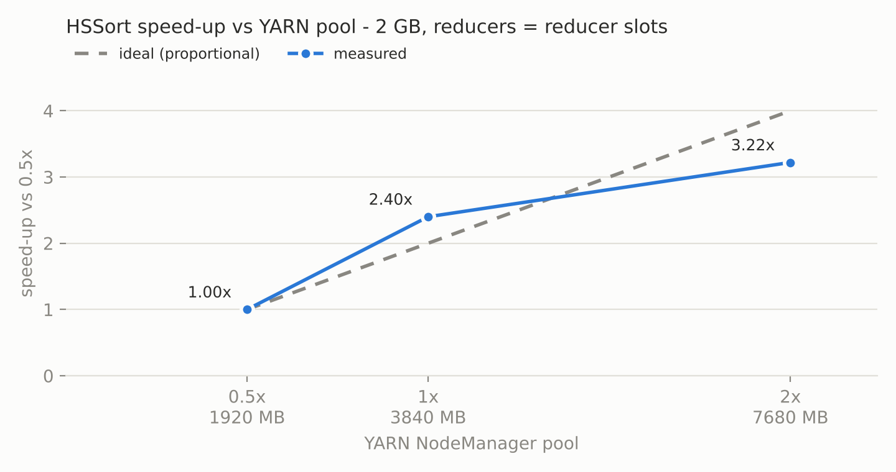

# TPCx-HS on a Single-Node Hadoop VM

Running the **TPCx-HS v2.0.3** big-data benchmark (HSGen → HSSort → HSValidate,
MapReduce) on a single node — an ARM64 VM for Milestone 2, an x86_64 WSL2 host
with the identical Hadoop configuration for Milestone 3 — at a scale far below
the specification's minimum, to study how the benchmark's three phases behave
on a memory-constrained configuration.

Yonsei University, Big Data course project, 2026-2. Milestones 2 and 3.

> **This is not a TPCx-HS result.** The run uses 1 GB of data on one node with
> replication 1; the specification requires ≥ 1 TB and replication ≥ 3. No
> HSph@SF metric is computed or claimed. See [Deviations](#deviations-from-the-specification).

---

## Project description

[TPCx-HS](https://www.tpc.org/tpcx-hs/) measures Hadoop cluster throughput by
sorting a large dataset of 100-byte records. We built the whole stack by hand on
one VM, generated and verified a dataset, and (Milestone 3) measure how the sort
and the validation pass behave as the configuration is changed.

| Milestone | Scope | Status |
|-----------|-------|--------|
| 2 | Architecture design, Hadoop build, HSGen 1 GB, verification | **Done** — on the Mac VM, in [jhkki034/big_data_benchmark](https://github.com/jhkki034/big_data_benchmark) |
| 3 | HSSort / HSValidate performance analysis, scalability test, this GitHub page | **Done** — reducers 1–7, maps 4/8/16, data 1–8 GB, YARN pool 0.5×–2× ([results](workload/RESULTS.md)) |

## System description

One host, pseudo-distributed Hadoop: five daemons in five JVMs over loopback.

| | Milestone 2 | Milestone 3 |
|---|---|---|
| Platform | UTM VM on macOS, Ubuntu 22.04 aarch64 | WSL2 on Windows, Ubuntu 24.04.2 x86_64 |
| Resources | 6 vCPU, 7.7 GiB RAM, 3.8 GiB swap, 30 GB disk | 20 vCPU, 15.4 GiB RAM, 4 GiB swap, 940 GB free |
| Software | Hadoop 3.3.6, Temurin JDK 8, TPCx-HS kit v2.0.3 (MR2 jar) — native libs for each arch | same |
| Daemons | NameNode, DataNode, SecondaryNameNode, ResourceManager, NodeManager | same |
| YARN pool | 3840 MB / 4 vcores: ApplicationMaster + 4 maps at 768 MB, or AM + 3 reducers at 1024 MB | **same, on purpose** |
| HDFS | replication 1, 128 MB blocks, `hdfs://localhost:8020` | same |

The WSL2 host is larger than the YARN pool it is given; the pool was kept equal
to the Mac VM's so that both run the same configuration. The same 1 GB dataset
(identical HSGen CHECKSUM) was regenerated on it.

### Technical details

Key settings ([`conf/hadoop/`](conf/hadoop/)):

| Setting | Value | Reason |
|---------|-------|--------|
| `fs.defaultFS` | `hdfs://localhost:8020` | the kit's `HSDataCheck` hardcodes this address |
| `yarn.nodemanager.resource.memory-mb` | 3840 | AM + 4 maps at 768 MB |
| `yarn.scheduler.minimum-allocation-mb` | 256 | at 512 a 768 MB request rounded to 1024 MB and only one map ran at a time |
| `yarn.nodemanager.vmem-check-enabled` | false | aarch64 JVMs reserve large virtual memory; physical limits stay enforced |
| Daemon heaps | 512/256/256/384/384 MB | five default 1 GB heaps would not fit in RAM |

Everything is installed under `~/project` without root.

## Workload

TPCx-HS is not a query benchmark. Its "queries" are three MapReduce programs
that run in sequence over one dataset of 100-byte records (10-byte key, 90-byte
value):

| Phase | Program | What it does | Shape |
|-------|---------|--------------|-------|
| 1 | **HSGen** | Generates records deterministically from the record number | map-only, write-bound |
| 2 | **HSSort** | Total-order sorts the whole dataset | map → shuffle → reduce, ~3× input in disk |
| 3 | **HSValidate** | Checks global key order and that no record was lost or changed | ordering + CRC32 sum |

Dataset: **1 GB = 10,000,000 records**, 4 files of 250 MB. HSGen CHECKSUM
`21472776955442690`, which HSValidate must reproduce after sorting.

Full description with diagrams, record layout and the validation logic:
[workload/README.md](workload/README.md).

## Results

> 📄 **Full report** — method, all runs, per-phase breakdown, discussion:
> **[English → workload/RESULTS.md](workload/RESULTS.md)** · **[한국어 → workload/REPORT_KO.md](workload/REPORT_KO.md)**
>
> Raw per-run data: [workload/runs/](workload/runs/) · Figures: [workload/figures/](workload/figures/)

### At a glance

| | Question | Answer |
|---|---|---|
| **Part 1 · Performance** | How should 1 GB be split up to sort fastest? | **3 reducers, 4–8 maps → ~57–59 s.** The YARN container pool, not the hardware, is the limit. |
| **Part 2 · Scalability** | What happens when data or resources grow? | **Data:** 8× the data in 6.3× the time. **Resources:** 4× the containers → 3.2× faster. |
| **Correctness** | Was every sort right? | **63 / 63** HSValidate runs passed, each against its dataset's HSGen checksum. |

Milestone 3 was measured on WSL2 (see [System description](#system-description)),
3 runs per setting, medians reported. Milestone 2 (Mac VM): HSGen of 1 GB took
**28.4 s** with 4 maps, verified byte-for-byte against an independent regeneration.

### Part 1 · Performance analysis

Same 1 GB dataset and YARN pool; only how the work is split changes.

<p>
  
  
</p>

**Experiment 1 — number of reducers** (8 maps)

| Reducers | 1 | 2 | **3** | 4 | 5 | 6 | 7 |
|----------|---|---|---|---|---|---|---|
| HSSort, s | 68.8 | 63.6 | **59.0** | 70.5 | 64.5 | 65.4 | 69.3 |

**Experiment 2 — number of maps** (3 reducers)

| Maps (split size) | 4 (250 MB) | 8 (128 MB) | 16 (64 MB) |
|-------------------|---|---|---|
| HSSort, s | **56.9** | 58.1 | 76.3 |

- The pool fits **4 maps or 3 reducers** at a time, and performance is best when
  each phase fits its slots. The map phase stays at ~35–40 s; the differences
  are in shuffle + reduce.
- One reducer more than fits adds a second reduce wave (**+19 %** at 4); too few
  reducers concentrate the merge (**+17 %** at 1); 64 MB maps pay start-up cost
  four waves over (**+31 %** at 16). HSValidate takes ~35 s whatever the setting.

➡️ Details: [Experiment 1](workload/RESULTS.md#experiment-1-number-of-reducers) ·
[Experiment 2](workload/RESULTS.md#experiment-2-number-of-maps) ·
[한국어 Part 1](workload/REPORT_KO.md#part-1-성능-분석-performance-analysis)

### Part 2 · Scalability test

Best setting from Part 1 (3 reducers); data size and resources grow.

<p>
  
  
</p>

**Experiment 3 — data size** (YARN pool 3840 MB)

| Data size | 1 GB | 2 GB | 4 GB | 8 GB |
|-----------|------|------|------|------|
| HSSort, s | 56.0 | 93.4 | 186.1 | 354.3 |
| s per GB | 56.0 | 46.7 | 46.5 | 44.3 |

**Experiment 4 — resources** (2 GB; reducers = reducer slots of each pool)

| YARN pool | 0.5× (1920 MB) | 1× (3840 MB) | 2× (7680 MB) |
|-----------|------|----|----|
| HSSort, s | 224.1 | 93.4 | 69.5 |
| Speed-up vs 0.5× | 1.00 | 2.40 | 3.22 |

- **Data:** 8× the data in 6.3× the time — better than linear; ~45 s per GB from
  2 GB on, and no memory wall up to 8 GB.
- **Resources:** 4× the containers → 3.2× faster (~80 % efficiency). Returns
  diminish past 1×, most likely because all containers share one disk.

➡️ Details: [Experiment 3](workload/RESULTS.md#experiment-3-scalability--data-size) ·
[Experiment 4](workload/RESULTS.md#experiment-4-scalability--resources) ·
[한국어 Part 2](workload/REPORT_KO.md#part-2-확장성-테스트-scalability-test)

### Data quality

Earlier trial runs predate the YARN fix of 2026-11-05 and are discarded. Runs
disturbed by host load — identified by setup and HSValidate times that do not
depend on the setting — were excluded and re-measured; they stay in the raw
data. See [Discarded runs](workload/RESULTS.md#discarded-runs).

## Execution commands

The TPCx-HS kit is **not** included (its EULA forbids redistribution). Download
it from <https://www.tpc.org/tpcx-hs/> and unpack it to
`~/project/TPCx-HS_Kit_v2.0.3`, or `export KIT_HOME=/path/to/TPCx-HS-Runtime-Suite`.

Run from the root of this repository:

```bash
./scripts/00-preflight.sh      # checks arch, RAM, disk, sshd, kit, mirrors
./scripts/01-install.sh        # JDK 8 + Hadoop 3.3.6 under ~/project/opt, apply conf/
./scripts/01b-setup-ssh.sh     # passwordless ssh to localhost
./scripts/02-format-hdfs.sh    # format NameNode
./scripts/03-start-cluster.sh  # start HDFS + YARN
./scripts/05-hsgen.sh 1        # HSGen, 1 GB
./scripts/07-hsdatacheck.sh    # kit's HSDataCheck + size accounting
```

Milestone 3 phases (command lines taken from the kit's own driver):

```bash
D=/user/$(id -un)/TPCx-HS-benchmark
hadoop jar $KIT_HOME/TPCx-HS-master_MR2.jar HSSort \
    -Dmapreduce.job.maps=4 -Dmapreduce.job.reduces=3 $D/HSsort-input $D/HSsort-output
hadoop jar $KIT_HOME/TPCx-HS-master_MR2.jar HSValidate $D/HSsort-output $D/HSvalidate
hdfs dfs -cat $D/HSvalidate/part-*   # PASS: only "checksum 4c49607ac53602" (= HSGen CHECKSUM)
```

The same, timed and repeated, as used for the results:

```bash
./scripts/08-hssort-validate.sh 3          # HSSort + HSValidate, 3 reducers, 3 runs
./scripts/09-hssort-validate-maps.sh 16 3  # 16 maps (via split size), 3 reducers, 3 runs
./scripts/10-phase-breakdown.sh            # setup / map / tail per run, from the saved logs
./scripts/11-batch-unattended.sh           # the 2026-11-24 batch, with hang protection
./scripts/12-scalability-batch.sh          # data 1/2/4/8 GB + YARN pool 0.5x/1x/2x, restores config
```

Everything is derived from `$HOME` and the current username, so no path edits
are needed on another machine. Expect ~5–15 min for `01-install.sh` (711 MB
download; it tries several mirrors because the default one stalls), seconds for
the rest, ~30 s for HSGen. `openssh-server` must be installed or no daemon
starts; `00-preflight.sh` checks for it. Both aarch64 and x86_64 are supported:
`00-env.sh` picks the matching Hadoop tarball and JDK, so the same steps work in
a UTM VM on Apple Silicon and in WSL2 on a PC.

**Full setup guide for a fresh VM** (VM sizing, kit location, build pitfalls, SSH, and how to run
Milestone 3): [SETUP.md](SETUP.md).

## Deviations from the specification

| Specification | This project | Why |
|---------------|--------------|-----|
| Scale factor ≥ 1 TB | 1 GB (performance), 1–8 GB (scalability) | ~10 GB of usable HDFS on the Mac VM; 1 GB kept as the baseline so results compare |
| Replication ≥ 3 | 1 | one node |
| Cluster of nodes | one VM | course constraint |
| `TPCx-HS-master.sh` driver | HSGen/HSSort/HSValidate invoked directly | the driver's smallest scale is 100 GB, it deletes data unprompted and needs `sudo` |
| Cluster Validation Suite | skipped | needs `clush`/`pdsh`; meaningless on one node |

Also: on the Mac VM, daemons and heaps share ~7.7 GiB with the editor server, so
timings are pessimistic; on WSL2 the host has spare capacity and the YARN pool,
not the hardware, is the limit. Software is installed under `$HOME` because
`sudo` needs a password.

## Repository layout

```
.
├── README.md             this page
├── conf/
│   ├── hadoop/           core/hdfs/yarn/mapred-site, hadoop-env, workers
│   └── kit/              our TPCx-HS parameter overlay (no kit files)
├── SETUP.md              build the cluster on a fresh VM, run Milestone 3
├── scripts/              numbered build/run scripts: 00 … 07 build, 08 … 12 Milestone 3, 99 optional
└── workload/
    ├── README.md         the benchmark workload and dataset
    ├── RESULTS.md        Milestone 3 report (English): method, results, discussion
    ├── REPORT_KO.md      Milestone 3 report (Korean), Part 1 / Part 2
    ├── figures/          the four Milestone 3 charts and the script that draws them
    └── runs/             raw per-run TSVs behind RESULTS.md
```

## Licence note

No TPCx-HS kit material is committed here (kit EULA v2.1, clause 4.a). The
scripts and configuration in this repository are our own work.
