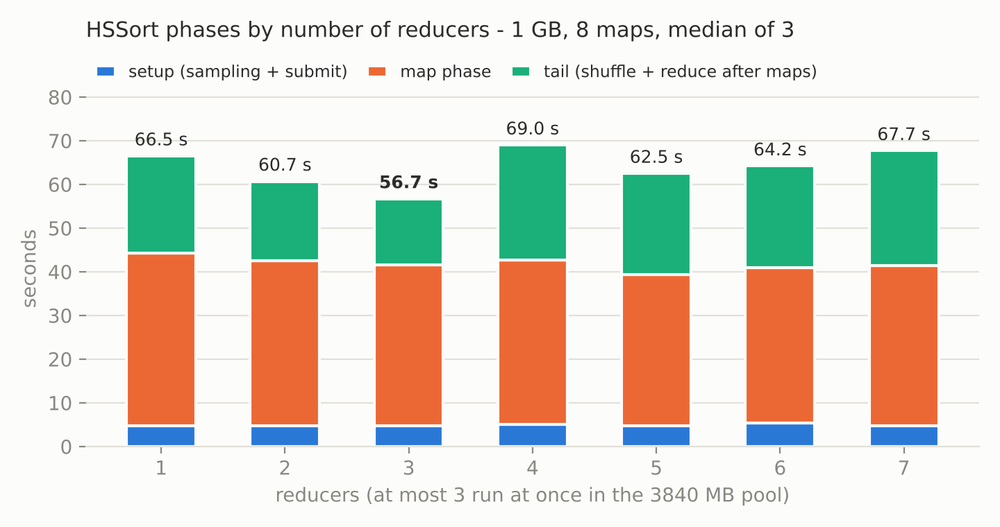
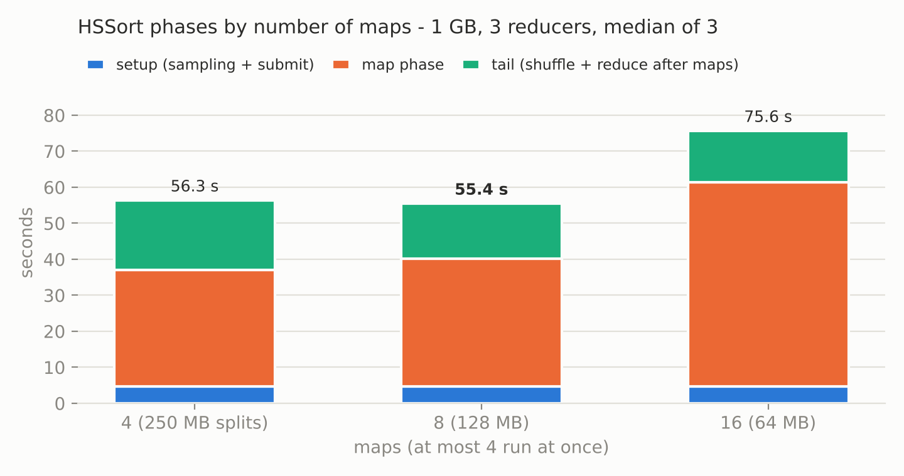
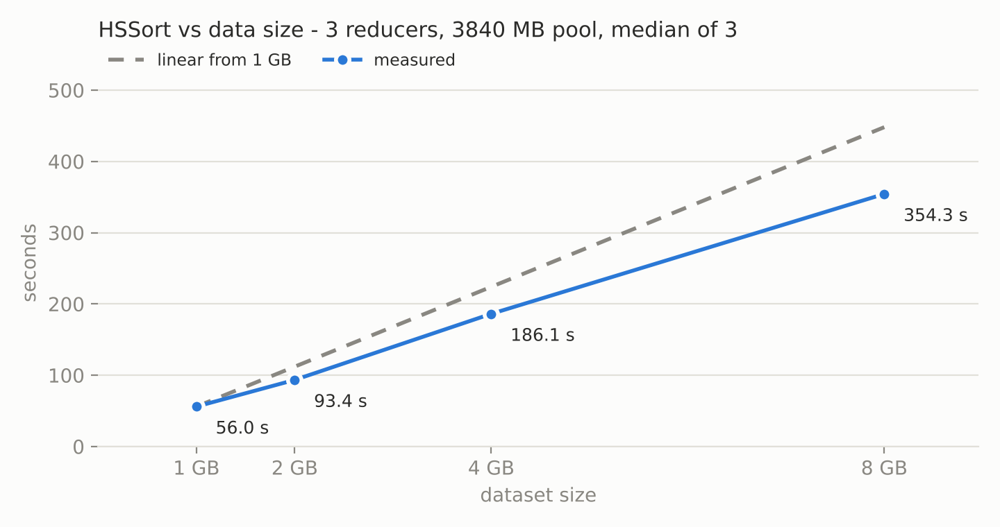
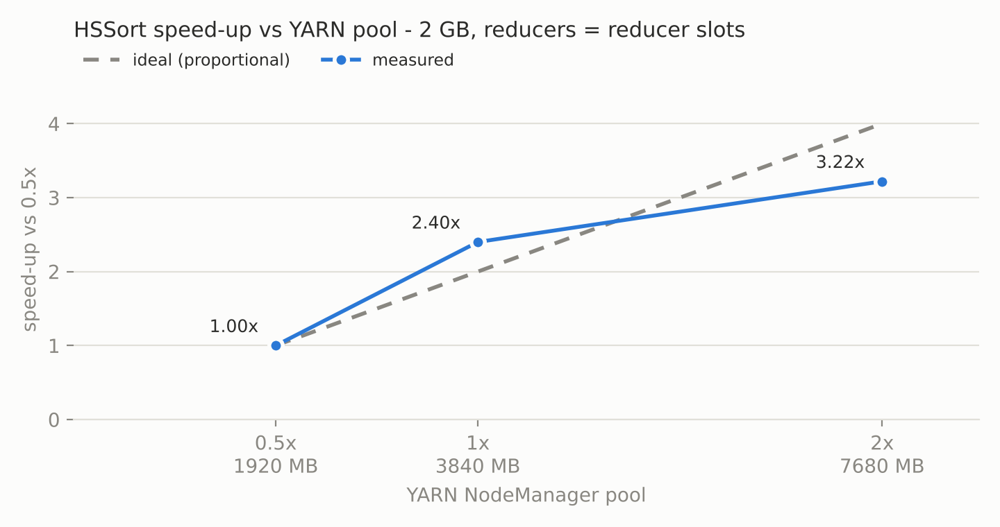

# Milestone 3 보고서: TPCx-HS 성능 분석과 확장성 테스트

연세대학교 빅데이터 수업 팀 프로젝트, 2026-2학기

> 이 보고서는 [RESULTS.md](RESULTS.md)(영문, 상세 표와 원본 데이터)의 내용을 한국어로 쉽게 정리한 것입니다. [프로젝트 첫 화면으로](../README.md)
> 단일 노드, 복제 1, 1–8 GB 규모라서 **공식 TPCx-HS 결과가 아니며**, 공식 지표(HSph@SF)도 계산하지 않았습니다.

## 목차

- [요약](#요약)
- [0. 배경과 실험 준비](#0-배경과-실험-준비)
- [Part 1. 성능 분석 (Performance Analysis)](#part-1-성능-분석-performance-analysis)
  - [실험 1: reducer 개수](#실험-1-reducer-개수)
  - [실험 2: map 개수](#실험-2-map-개수)
  - [성능 분석 정리](#성능-분석-정리)
- [Part 2. 확장성 테스트 (Scalability Test)](#part-2-확장성-테스트-scalability-test)
  - [실험 3: 데이터 크기 확장](#실험-3-데이터-크기-확장)
  - [실험 4: 자원 확장](#실험-4-자원-확장)
  - [확장성 테스트 정리](#확장성-테스트-정리)
- [측정 품질 관리](#측정-품질-관리)
- [결론](#결론)
- [한계와 향후 과제](#한계와-향후-과제)

---

## 요약

### Part 1. 성능 분석: 같은 1 GB를 어떻게 나눠 처리하면 가장 빠른가?

| 실험 | 바꾼 것 | 최적 | 핵심 결과 |
|---|---|---|---|
| 실험 1 | reducer 1~7개 | **3개 (59.0초)** | 동시에 뜰 수 있는 3개에 맞출 때 가장 빠름. 4개부터 두 번에 나눠 돌아 느려짐 |
| 실험 2 | map 4 / 8 / 16개 | **4~8개 (약 57~58초)** | 4와 8은 비슷, 16개는 준비 시간이 쌓여 31% 느림 |

### Part 2. 확장성 테스트: 규모를 키우면 성능이 어떻게 변하는가?

| 실험 | 키운 것 | 핵심 결과 |
|---|---|---|
| 실험 3 | 데이터 1 → 8 GB | **8배 데이터 → 6.3배 시간.** 정비례보다 약간 좋게 확장 |
| 실험 4 | YARN 자원 0.5 → 2배 | **자원 4배 → 3.2배 빨라짐.** 2배를 넘으면 디스크 병목으로 효과 감소 |

**정확성**: 모든 실험에서 HSValidate **63회 전부 통과.** 정렬 중 레코드가 하나도 빠지거나 바뀌지 않았습니다.

---

## 0. 배경과 실험 준비

### 0-1. TPCx-HS란

100바이트짜리 레코드를 대량으로 **정렬하는 속도**로 Hadoop 클러스터 성능을 재는 벤치마크입니다.

| 단계 | 하는 일 |
|---|---|
| **HSGen** | 정렬할 데이터를 생성 (1 GB = 레코드 1000만 개) |
| **HSSort** | 전체 데이터를 키 순서대로 정렬 ← **이번 측정의 핵심** |
| **HSValidate** | 정렬이 맞는지, 빠지거나 바뀐 레코드가 없는지 검사 |

### 0-2. map, shuffle, reduce

HSSort는 MapReduce로 동작합니다. 숫자 1~24를 정렬한다고 하면:

1. **map**: 뒤섞인 원본을 몇 덩어리로 잘라 여러 일꾼이 나눠 읽습니다. 각자 자기 덩어리를 정렬한 뒤 "1~8 / 9~16 / 17~24"처럼 **값의 구간별로 나눠** 둡니다.
2. **shuffle**: 같은 구간 조각들을 그 구간 담당 reducer에게 배달합니다.
3. **reduce**: 각 reducer가 받은 조각들(이미 정렬됨)을 합쳐 자기 구간을 완성하고 파일로 씁니다. 파일들을 순서대로 이어 붙이면 전체가 정렬된 상태가 됩니다.

> **map 개수** = 원본을 몇 덩어리로 나눠 읽을지
> **reducer 개수** = 결과를 몇 구간으로 나눠 동시에 합칠지

### 0-3. 가장 중요한 전제: "자리"가 정해져 있다

YARN에 일꾼용 메모리를 3840 MB만 줬기 때문에, 관리자(ApplicationMaster, 768 MB)를 빼면 동시에 이만큼만 뜰 수 있습니다.

| 일꾼 | 크기 | 동시에 뜰 수 있는 수 |
|---|---|---|
| map | 768 MB | **4개** |
| reducer | 1024 MB | **3개** |

이번 결과 대부분은 이 자리 제한으로 설명됩니다.

### 0-4. 실험 환경

| 항목 | Milestone 2 (팀원, 맥) | **Milestone 3 (이번 측정)** |
|---|---|---|
| 환경 | macOS 위 UTM 가상머신 | **Windows 위 WSL2** |
| OS / CPU 구조 | Ubuntu 22.04 / ARM64 | Ubuntu 24.04 / x86_64 |
| CPU / 메모리 | 6코어 / 7.7 GB | 20코어 / 15.4 GB |
| Hadoop / Java | 3.3.6 / JDK 8 | 3.3.6 / JDK 8 |
| YARN 메모리 | 3840 MB | **3840 MB (일부러 같게 유지)** |

- PC 성능은 훨씬 넉넉하지만, 맥 환경과 **같은 설정**을 비교하기 위해 YARN 메모리를 그대로 뒀습니다.
- 데이터는 WSL2에서 다시 생성했고, HSGen 체크섬이 맥과 **똑같이**(`21472776955442690`) 나와 바이트 단위로 같은 데이터임을 확인했습니다.
- ARM64용으로 고정돼 있던 설치 스크립트를 CPU 구조에 맞는 Hadoop과 JDK를 자동으로 고르도록 고쳤습니다.

### 0-5. 측정 방법

- 모든 설정을 **3번씩** 돌리고 **중간값**을 사용했습니다.
- 매 회차마다 이전 결과를 지우고 HSSort → HSValidate 순서로 실행하며 시간을 쟀습니다(`scripts/08`~`12`).
- HSSort 시간은 로그로 **준비(샘플링+제출) / map 단계 / map 이후(셔플+리듀스)** 세 부분으로 쪼개 원인을 분석했습니다.
- **HSValidate 통과 기준**: 출력에 오류 줄이 없고, 출력된 체크섬이 그 데이터의 HSGen 체크섬과 같으면 통과입니다.
  (기존 문서의 "출력 폴더가 비어 있으면 통과"는 실제 동작과 달라 바로잡았습니다. 실제로는 항상 체크섬 한 줄이 출력됩니다.)

---

## Part 1. 성능 분석 (Performance Analysis)

> **질문: 같은 1 GB 데이터를 어떻게 나눠 처리하면 가장 빠른가?**
> 데이터와 자원은 고정하고, 일을 나누는 방식(reducer 수, map 수)만 하나씩 바꿨습니다.

### 실험 1: reducer 개수

#### 설정
| 고정 | 바꾼 것 |
|---|---|
| 1 GB, map 8개, YARN 3840 MB | **reducer 1 ~ 7개** |

#### 결과

| reducer | 1 | 2 | **3** | 4 | 5 | 6 | 7 |
|---|---|---|---|---|---|---|---|
| HSSort (초) | 68.8 | 63.6 | **59.0** | 70.5 | 64.5 | 65.4 | 69.3 |
| map 단계 (초) | 39.6 | 37.7 | 36.7 | ~38 | 34.6 | 35.6 | 36.7 |
| map 이후 구간 (초) | 22.2 | 18.2 | **15.2** | 26.3 | 23.2 | 23.3 | 26.3 |
| 실제 띄운 reducer | 1 | 2 | 3 | **5** | **6** | **6** | **7~8** |

#### 해석
**reducer 3개가 가장 빠르고, 그보다 적어도 많아도 느려지는 U자 모양입니다.**

- **map 단계는 reducer 수와 상관없이 35~40초로 거의 같습니다.** 차이는 전부 **map이 끝난 뒤(셔플+리듀스)**에서 납니다.
- **1~2개**: 한두 명이 1 GB 합치기를 다 떠안아서 느립니다.
- **3개**: 자리 3개를 꽉 채워 한 번에 끝납니다. 가장 빠릅니다.
- **4개 이상**: 자리가 3개뿐이라 남는 reducer는 기다렸다가 **두 번째 차례**에 돕니다. 4개는 마지막 한 명이 1/4을 혼자 처리해서 가장 느리고, 5~6개는 두 번째 차례를 2~3명이 나눠서 조금 낫습니다.
- **추가 발견**: 4개 이상에서는 실제로 띄운 reducer가 지정한 수보다 많았습니다(4개 → 5개). 늦게 끝나는 일꾼의 **예비 복사본(speculative execution)**으로 보이며, 모자란 자리를 복사본이 차지해 손해가 커집니다.

### 실험 2: map 개수

#### 설정
| 고정 | 바꾼 것 |
|---|---|
| 1 GB, reducer 3개(실험 1의 최적), YARN 3840 MB | **map 4 / 8 / 16개** (덩어리 크기로 조절) |

#### 결과

| map (덩어리 크기) | 4 (250 MB) | 8 (128 MB) | 16 (64 MB) |
|---|---|---|---|
| HSSort (초) | **56.9** | 58.1 | 76.3 |
| map 단계 (초) | 32.5 | 35.6 | **56.8** |
| map 이후 구간 (초) | 19.2 | 15.2 | 14.2 |
| 디스크 임시 쓰기 (spill 레코드) | **3000만** | 2000만 | 2000만 |

#### 해석
**4개와 8개는 사실상 같고(1초 차이는 오차 범위), 16개는 31% 느립니다.**

- **4개**: 자리 4개에 딱 맞아 map이 한 번에 끝납니다(빠름). 대신 덩어리가 커서 정렬 버퍼(200 MB)를 넘쳐 디스크에 한 번 더 썼다 읽습니다(느림).
- **8개**: map이 두 번에 나눠 돌지만(느림), 덩어리가 버퍼에 들어가 추가 디스크 작업이 없습니다(빠름).
- **16개**: 덩어리를 잘게 나누니 일꾼을 띄우는 준비 시간이 네 번이나 쌓여서, map 단계만 20초 넘게 늘어납니다.

### 성능 분석 정리

- 이 환경의 성능은 **YARN의 자리 수**가 결정합니다.
- **각 단계가 자리에 딱 맞게 나뉠 때** 가장 빠릅니다: map 4~8개, reducer 3개.
- 느려지는 세 가지 경우:
  1. 자리를 넘겨 **한 번 더 돌아야 할 때** (reducer 4개 이상)
  2. 너무 적게 나눠 **한 명에게 일이 몰릴 때** (reducer 1~2개)
  3. 너무 잘게 나눠 **준비 시간이 쌓일 때** (map 16개)
- HSValidate는 설정과 무관하게 약 35초로 일정했습니다.

---

## Part 2. 확장성 테스트 (Scalability Test)

> **질문: 처리할 규모나 쓸 수 있는 자원을 키우면 성능이 어떻게 변하는가?**
> Part 1의 최적 설정(reducer 3개)을 기준으로, 데이터 크기와 자원을 각각 키웠습니다.

### 실험 3: 데이터 크기 확장

#### 설정
| 고정 | 바꾼 것 |
|---|---|
| reducer 3개, map은 128 MB 덩어리 기준 자동, YARN 3840 MB | **데이터 1 → 2 → 4 → 8 GB** (크기마다 HSGen으로 새로 생성) |

> 물어보는 것: 데이터가 2배가 되면 시간도 2배가 되는가?

#### 결과

| 데이터 | 1 GB | 2 GB | 4 GB | 8 GB |
|---|---|---|---|---|
| map 개수 | 8 | 16 | 32 | 60 |
| HSSort (초) | 56.0 | 93.4 | 186.1 | 354.3 |
| 이전 크기 대비 | — | 1.67배 | 1.99배 | 1.90배 |
| GB당 시간 (초) | 56.0 | 46.7 | 46.5 | **44.3** |
| HSValidate (초) | 32.4 | 35.4 | 40.8 | 50.4 |
| HSGen (초) | 30.3 | 33.3 | 45.1 | 55.7 |

크기마다 HSValidate가 그 크기의 HSGen 체크섬과 일치해 12회 모두 통과했습니다.

#### 해석
**데이터 8배에 시간 6.3배. 정비례 선보다 항상 아래에 있어 확장성이 좋습니다.**

- 2 GB부터는 데이터를 2배로 늘릴 때마다 시간도 거의 정확히 2배씩 늘고, **GB당 시간은 약 45초로 일정**합니다.
- 1 GB가 상대적으로 비효율적인 건 준비 단계, 잡 시작 같은 **고정 비용**이 작은 데이터에서 비중이 크기 때문입니다.
- 8 GB까지 디스크 임시 쓰기(spill)가 최소 수준을 유지해, **메모리 부족으로 느려지는 지점에는 아직 닿지 않았습니다.**
- HSGen과 HSValidate는 데이터보다 훨씬 덜 늘어납니다. 고정 비용 비중이 크고, 방금 쓴 데이터를 메모리 캐시에서 읽는 효과도 있어 다소 낙관적인 값입니다.

### 실험 4: 자원 확장

#### 설정
| 고정 | 바꾼 것 |
|---|---|
| 데이터 2 GB | **YARN 메모리 0.5배 / 1배 / 2배**, reducer 수는 각 자원에서 동시에 뜰 수 있는 최대치 |

> 물어보는 것: 자원을 2배 주면 2배 빨라지는가? (서버를 더 붙이는 상황을 한 대 안에서 흉내 냄)

#### 결과

| YARN 자원 | 0.5배 (1920 MB) | 1배 (3840 MB) | 2배 (7680 MB) |
|---|---|---|---|
| 동시 map / reducer | 1 / 1 | 4 / 3 | 9 / 6 |
| HSSort (초) | 224.1 | 93.4 | 69.5 |
| map 단계 (초) | 180.6 | 65.8 | 44.8 |
| map 이후 구간 (초) | 37.2 | 21.2 | 18.2 |
| **0.5배 대비 속도** | 1.00배 | **2.40배** | **3.22배** |

9회 모두 HSValidate 통과했습니다.

#### 해석
**자원 4배에 3.2배 빨라져, 이상적인 값의 약 80%입니다.**

- **0.5배 → 1배 (2.40배)**: 이상적인 2배보다 좋습니다. 0.5배는 map이 한 번에 1개씩, reducer도 1개라 일이 극단적으로 몰려 있어서, 자원을 늘리자 병목 두 개가 한꺼번에 풀렸습니다.
- **1배 → 2배 (1.34배)**: 효과가 크게 줄어듭니다. 동시 map을 4개에서 9개로 늘려도 map 단계는 65.8초에서 44.8초로만 줄었습니다.
- 원인은 **모든 일꾼이 PC의 디스크 하나를 나눠 쓰기 때문**으로 추정됩니다. CPU(20코어)와 메모리는 남는데 디스크가 먼저 한계에 닿는 것입니다. 실제 클러스터는 서버마다 디스크가 따로 있어 이 병목이 덜합니다. (디스크 사용률을 직접 재지는 않았으므로 추정입니다.)

### 확장성 테스트 정리

| 방향 | 결과 | 의미 |
|---|---|---|
| **데이터 확장** | 8배 데이터 → 6.3배 시간 | 정비례보다 좋음. 8 GB까지 한계 없음 |
| **자원 확장** | 4배 자원 → 3.2배 속도 | 2배까지는 효과 큼, 그 이상은 단일 디스크 병목 |

---

## 측정 품질 관리

설정과 무관하게 거의 일정한 두 값, **준비 단계(평소 약 5초)**와 **HSValidate 시간**을 "PC 상태 지표"로 썼습니다. 이 두 값이 같이 튄 회차는 PC가 다른 일로 바빴던 것으로 보고 제외한 뒤 다시 쟀습니다.

| 제외한 측정 | 해당 Part | 이유 | 대응 |
|---|---|---|---|
| 11/21 저녁 reducer 7, 9회 (85~98초) | Part 1 | HSValidate(48~52초)와 준비 단계(6~9초)까지 함께 느려짐. 클러스터를 재시작해도 그대로라 클러스터 문제도 아님 | 11/24에 재측정 (69.3초) |
| 11/24 오후 첫 1 GB, 2 GB 측정 6회 | Part 2 | 준비 단계 6.0~6.4초, HSValidate 42~46초로 평소보다 느림 | 같은 날 PC를 쓰지 않는 상태로 재측정 |

- 이틀에 나눠 측정했지만, 같은 설정(map 8 + reducer 3)이 **59.0초(11/21)와 58.1초(11/24)**로 거의 같아서 두 날의 결과를 함께 쓸 수 있음을 확인했습니다.
- 제외한 측정도 원본 데이터(`runs/`)에는 그대로 남겨 두었습니다.

---

## 결론

**Part 1. 성능 분석**
1. 성능을 결정하는 건 하드웨어가 아니라 **YARN의 자리 수**입니다.
2. 최적 설정은 **reducer 3개, map 4~8개**로, 각 단계가 자리에 딱 맞을 때입니다.

**Part 2. 확장성 테스트**
3. **데이터 확장성은 좋습니다.** 8배 데이터를 6.3배 시간에 처리했고, 2 GB 이상에서 GB당 시간이 일정합니다.
4. **자원 확장성은 2배까지 크고 그 이후 줄어듭니다.** 자원 4배에 3.2배 빨라졌으며, 단일 디스크가 다음 병목으로 보입니다.

**공통**
5. **정확성은 모든 조건에서 유지되었습니다.** HSValidate 63회 모두 해당 데이터의 HSGen 체크섬과 일치했습니다.

---

## 한계와 향후 과제

- 서버 한 대, 복제 1, 최대 8 GB라서 실제 클러스터나 공식 결과와 직접 비교할 수 없습니다.
- "자원 확장"은 한 대 안에서 YARN 메모리만 늘린 것이라, 디스크와 OS를 공유한다는 점에서 서버 추가와 다릅니다.
- 디스크와 CPU 사용률을 측정하면 실험 4의 디스크 병목 추정을 확인할 수 있습니다.
- 예비 복사본(speculative execution) 여부는 로그의 `Killed reduce tasks` 값으로 확정할 수 있습니다.
- 8 GB보다 큰 데이터, 2배보다 큰 자원은 PC 메모리(15 GB) 한계로 시험하지 않았습니다.
