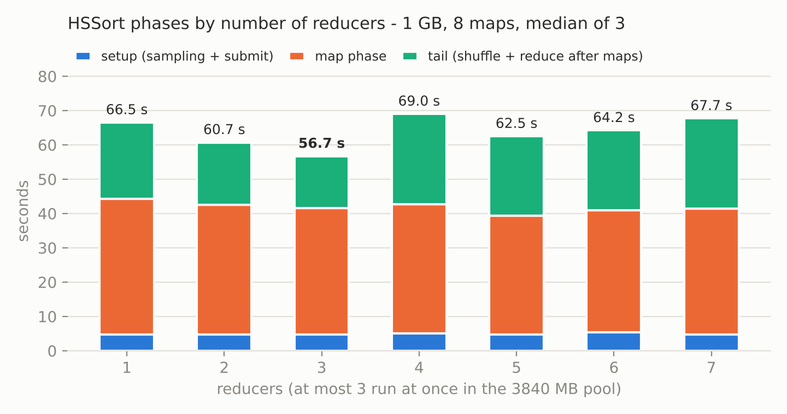
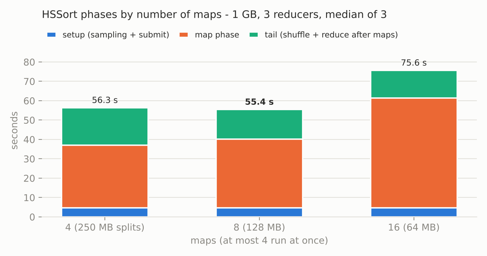
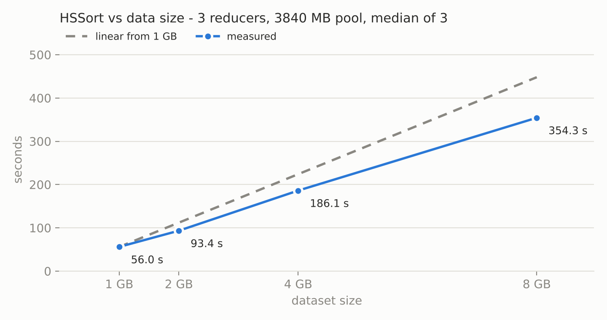
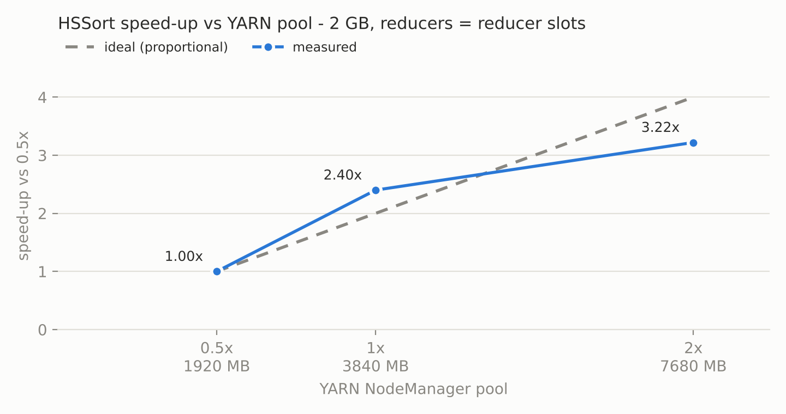

# Results

> 한국어로 쉽게 정리한 버전: [REPORT_KO.md](REPORT_KO.md) · Back to the [project page](../README.md)

## Status

| Phase | Measured | Where |
|-------|----------|-------|
| HSGen, 1 GB | **Yes** (Milestone 2 on the Mac VM, re-run once on WSL2) | [HSGen](#hsgen) |
| HSSort, 1 GB, reducers 1–7 | **Yes**, 3 runs each | [Experiment 1](#experiment-1-number-of-reducers) |
| HSSort, 1 GB, maps 4 / 8 / 16 | **Yes**, 3 runs each | [Experiment 2](#experiment-2-number-of-maps) |
| HSValidate | **Yes**, after every HSSort run — 63 / 63 PASS (incl. 15 discarded runs) | every table below |
| Scalability: data 1 / 2 / 4 / 8 GB | **Yes**, 3 runs each | [Experiment 3](#experiment-3-scalability--data-size) |
| Scalability: YARN pool 0.5× / 1× / 2× | **Yes**, 3 runs each | [Experiment 4](#experiment-4-scalability--resources) |

All Milestone 3 numbers were measured on the **WSL2 machine** described below,
on 2026-11-21 and 2026-11-24, with the YARN configuration unchanged from the Mac
VM (3840 MB pool, 768 MB maps, 1024 MB reducers). The 2026-11-04 trial runs on
the Mac VM predate the YARN fix of 2026-11-05 and are not quoted.

## Test machine (Milestone 3)

| | Milestone 2 (Mac) | **Milestone 3 (WSL2)** |
|---|---|---|
| Host | UTM VM on macOS | WSL2 on Windows |
| OS / arch | Ubuntu 22.04 aarch64 | Ubuntu 24.04.2 x86_64 |
| vCPU / RAM / swap | 6 / 7.7 GiB / 3.8 GiB | 20 / 15.4 GiB / 4 GiB |
| Disk free | ~10 GB usable for HDFS | 940 GB |
| Hadoop / JDK | 3.3.6 aarch64 / Temurin 8 | 3.3.6 x86_64 / Temurin 8 (x64) |
| YARN pool | 3840 MB / 4 vcores | **same** |

The host has far more CPU and memory than YARN is given. The pool was kept
identical on purpose so that the configuration under study is the same one the
Mac VM runs; concurrency is therefore limited by YARN, not by the hardware.
Concretely, beside the 768 MB ApplicationMaster there is room for **4 maps**
(768 MB) or **3 reducers** (1024 MB) at a time.

Porting to x86_64 needed only the binaries: `scripts/00-env.sh` now selects the
Hadoop tarball and JDK by `uname -m`, and `01-install.sh` verifies the x86_64
tarball against Apache's published SHA-512.

## HSGen

| | Mac VM (Milestone 2) | WSL2 (2026-11-21) |
|---|---|---|
| Records / bytes | 10,000,000 / 1,000,000,000 | 10,000,000 / 1,000,000,000 |
| Map tasks | 4 | 4 |
| Wall clock | 28.356 s (pool 2560 MB, one map at a time) | 39.5 s (1 run, first job after cluster start) |
| CHECKSUM | 21472776955442690 | **21472776955442690** |

Identical CHECKSUM on both machines: the WSL2 dataset is byte-for-byte the Mac
one, so every Milestone 3 run sorts the same data. `07-hsdatacheck.sh` reports
4 × 250,000,000 B, 7.5 blocks, filesystem HEALTHY. The two wall-clock values are
not comparable (different machine, different YARN configuration, one run each).

## Method

- `scripts/08-hssort-validate.sh <reducers> [runs]` and
  `scripts/09-hssort-validate-maps.sh <4|8|16> <reducers> [runs]` run HSSort then
  HSValidate with the kit's command lines, delete both output directories before
  each run, time each step, and append one row per run to a TSV.
- `scripts/10-phase-breakdown.sh` reads the saved job logs back and splits each
  HSSort run into **setup** (input sampling + submit), **map** (until `map 100%`)
  and **tail** (rest of shuffle + reduce), plus the job counters.
- `scripts/11-batch-unattended.sh` ran the 2026-11-24 batch (15 runs) with a
  480 s limit per run and automatic cluster restart; no run hit the limit.
- `scripts/12-scalability-batch.sh` ran Experiments 3–4: it regenerates the
  input at each size (checking HSValidate against that size's HSGen checksum),
  rewrites the NodeManager pool for the resource runs, and restores
  `yarn-site.xml` and the 1 GB dataset (checksum `21472776955442690`) at the end.
- Every setting: **3 runs, median reported.** Raw rows are kept in
  [`runs/`](runs/). Figures are drawn from these medians by
  [`figures/make_figures.py`](figures/make_figures.py); stacked bars show the
  job-log phases, which sum to 1–2 s less than the wall-clock medians in the tables.

### How HSValidate was judged

The output directory is **not** empty on a pass. Every run in this page wrote
exactly one line:

```
checksum        4c49607ac53602
```

`0x4c49607ac53602` = `21472776955442690`, the HSGen CHECKSUM. A run counts as
PASS when the output contains no `misorder` / `bad key` line **and** this
checksum equals HSGen's (order and preservation, see
[workload/README.md](README.md#3-hsvalidate--correctness)).

---

## Part 1 · Performance analysis

*How should the same 1 GB be split up to sort fastest?* Data and YARN pool are
fixed; only the number of reducers (Experiment 1) and maps (Experiment 2) changes.

## Experiment 1: number of reducers

Fixed: 1 GB, HSSort maps = **8** (one per 128 MB split — `-Dmapreduce.job.maps=4`
is only a hint and Hadoop ignored it; confirmed by `number of splits:8` in every
log), default shuffle settings. Changed: reducers 1 … 7.

### Wall clock

| Reducers | HSSort runs (s) | **HSSort median** | HSValidate median | Validate |
|---------:|-----------------|------------------:|------------------:|----------|
| 1 | 72.1 / 66.2 / 68.8 | **68.8** | 39.0 | 3/3 PASS |
| 2 | 60.3 / 63.7 / 63.6 | **63.6** | 36.0 | 3/3 PASS |
| 3 | 58.5 / 61.6 / 59.0 | **59.0** | 34.5 | 3/3 PASS |
| 4 | 70.5 / 72.0 / 69.9 | **70.5** | 35.9 | 3/3 PASS |
| 5 | 64.5 / 63.4 / 65.2 | **64.5** | 34.7 | 3/3 PASS |
| 6 | 65.4 / 62.3 / 66.4 | **65.4** | 34.9 | 3/3 PASS |
| 7 | 81.1 / 69.3 / 67.2 | **69.3** | 38.7 | 3/3 PASS |

Reducers 1 and 7 are from 2026-11-24, the rest from 2026-11-21. Drift check:
the 2026-11-24 batch also ran maps 8 / reducers 3, the same setting as the
2026-11-21 reducer-3 row, and got a median of **58.1 s vs 59.0 s**, so the two
days are comparable.



### Per phase (medians, seconds)

| Reducers | setup | map | **tail** | Reduce attempts launched | Sum of reduce-task time |
|---------:|------:|----:|---------:|-------------------------:|------------------------:|
| 1 | 4.7 | 39.6 | 22.2 | 1 | 21 |
| 2 | 4.8 | 37.7 | 18.2 | 2 | 34 |
| 3 | 4.8 | 36.7 | **15.2** | 3 | 43 |
| 4 | 5.1 | ~38 | 26.3 | **5** | 51 |
| 5 | 4.7 | 34.6 | 23.2 | **6** | 54 |
| 6 | 5.3 | 35.6 | 23.3 | **6** | 62 |
| 7 | 4.7 | 36.7 | 26.3 | **7–8** | 57 |

Spilled records are 20,000,000 (each record spilled once on the map side, once
on the reduce side) and shuffle volume 992 MB in every run.

### Reading it

- **Reducers 3 is fastest (59.0 s); the curve is U-shaped**, not "more is
  faster": +8 % at 2, +17 % at 1, +19 % at 4.
- **The map phase barely moves (≈ 35–40 s).** The whole difference sits in the
  **tail**, which is shortest at 3 reducers.
- **Below 3**, one or two reducers merge all 992 MB alone — the tail grows to
  18 s (2) and 22 s (1).
- **Above 3**, the reducers no longer fit in the pool at once (3 × 1024 MB beside
  the AM), so the reduce side runs in two waves and the tail jumps to 23–26 s.
  Reducers 5 and 6 are a little faster than 4: their second wave is shared by
  2–3 reducers each holding 1/5–1/6 of the data, while at 4 one reducer holds
  1/4 alone.
- **More attempts than requested were launched from 4 reducers up** (5 for 4,
  6 for 5 and 6, 7–8 for 7), never at 1–3. This is most likely MapReduce
  speculative execution duplicating the slow last reducer, which then also
  competes for the three reducer slots. To confirm: the `Killed reduce tasks`
  counter in those logs should equal the surplus.
- **HSValidate (≈ 35 s) does not depend on the reducer count**: it reads the
  sorted output once.

### Discarded runs

Nine reducer-7 runs from the evening of 2026-11-21 (18:35–19:40) are excluded.
They took 85–98 s, but **in the same runs HSValidate (48–52 s instead of
~35 s) and the setup phase (6–9 s instead of ~5 s) were slow too** — two steps
that do not depend on the reducer count. The machine was busy, not the
configuration; restarting the cluster did not help, which also rules out
cluster state. Reducer 7 was re-measured on 2026-11-24. Their rows remain in
[`runs/`](runs/) for the record. The first reducer-7 run of 2026-11-24 (81.1 s,
setup 6.3 s, first job after three idle days) is kept, as the protocol reports
all three runs; the median is unaffected.

## Experiment 2: number of maps

Fixed: 1 GB, reducers = 3 (the best of Experiment 1). Changed: the split size,
which sets the number of HSSort maps (`split.minsize = 250000000` → 4,
default → 8, `split.maxsize = 64 MiB` → 16). The real count was read back from
each log and matched the target in all 9 runs. Runs were interleaved
(4, 8, 16, 4, 8, 16, …) so that any drift is spread over all three settings.

| Maps (split) | HSSort runs (s) | **HSSort median** | map | tail | Spilled records | HSValidate median |
|-------------:|-----------------|------------------:|----:|-----:|----------------:|------------------:|
| 4 (250 MB) | 60.2 / 56.9 / 56.0 | **56.9** | 32.5 | 19.2 | **30,000,000** | 34.4 |
| 8 (128 MB) | 59.0 / 58.1 / 55.0 | **58.1** | 35.6 | 15.2 | 20,000,000 | 34.5 |
| 16 (64 MB) | 76.3 / 76.2 / 81.3 | **76.3** | **56.8** | 14.2 | 20,000,000 | 34.6 |

All 9 HSValidate runs PASS.



### Reading it

- **4 and 8 maps tie** (56.9 vs 58.1 s, within run-to-run spread), for opposite
  reasons. Four maps fit the four map slots, so the map phase is one wave and
  the shortest (32.5 s); but a 250 MB split overflows the map-side sort buffer,
  so records are spilled and merged once more (30 M spilled vs 20 M) and the
  tail is longer (19.2 s). Eight maps need two waves, but each 128 MB split
  sorts without an extra spill.
- **16 maps is clearly worse (+31 %).** Four waves of short tasks multiply the
  per-task start-up cost; the map phase alone grows by ~21 s. Smaller map
  outputs make the tail slightly shorter (14.2 s), nowhere near enough to pay
  for it.

---

## Part 2 · Scalability test

*What happens when the data or the resources grow?* Starting from the best
setting of Part 1 (3 reducers), the dataset grows from 1 to 8 GB (Experiment 3)
and the YARN pool from 0.5× to 2× (Experiment 4).

## Experiment 3: scalability — data size

Fixed: 3 reducers, one map per 128 MB split, YARN pool 3840 MB. Changed: the
dataset, regenerated with HSGen at each size. Times are wall clock (medians of
3); *map* and *tail* come from the job logs.

| Size | Maps | HSSort runs (s) | **HSSort median** | vs previous size | s per GB | map | tail | HSValidate | HSGen |
|-----:|-----:|-----------------|------------------:|-----------------:|---------:|----:|-----:|-----------:|------:|
| 1 GB | 8 | 55.1 / 56.0 / 56.0 | **56.0** | — | 56.0 | 34.5 | 15.2 | 32.4 | 30.3 |
| 2 GB | 16 | 94.5 / 93.4 / 91.3 | **93.4** | ×1.67 | 46.7 | 65.8 | 21.2 | 35.4 | 33.3 |
| 4 GB | 32 | 188.2 / 186.1 / 185.4 | **186.1** | ×1.99 | 46.5 | 145.5 | 34.2 | 40.8 | 45.1 |
| 8 GB | 60 | 354.2 / 356.7 / 354.3 | **354.3** | ×1.90 | 44.3 | 285.4 | 63.4 | 50.4 | 55.7 |

All 12 HSValidate runs PASS against the checksum of their own size
(1 GB `21472776955442690`, 2 GB `42957274697559007`, 4 GB `85904283600301578`,
8 GB `171810891145487470`). Spilled records are exactly 2 × the record count at
every size (160 M at 8 GB).



**Reading it**

- **HSSort scales slightly better than linearly: 8× the data takes 6.3× the
  time.** From 2 GB on, each doubling costs ×1.9–2.0 and the cost settles at
  ~45 s per GB.
- 1 GB is the least efficient point (56 s/GB) because fixed costs — input
  sampling and submit (~5 s), job and task start-up — weigh most on the
  smallest job.
- No sign of a memory wall up to 8 GB: spills stay at the minimum (one per
  record per side), so the reducers' 1024 MB containers are not yet the limit.
- HSGen (30 → 56 s) and HSValidate (32 → 50 s) grow far less than the data.
  Both are dominated by fixed job cost at these sizes, and HSValidate reads
  output that was just written and is likely still in the host's page cache
  (15 GiB RAM); treat their scaling as optimistic.

## Experiment 4: scalability — resources

Fixed: 2 GB. Changed: the NodeManager pool (`yarn.nodemanager.resource.memory-mb`
/ `cpu-vcores`), with reducers set to the reducer slots of each pool — a
single-host stand-in for adding nodes. The 1× point is the 2 GB row of
Experiment 3.

| Pool | Concurrent maps / reducers | Reducers | HSSort runs (s) | **HSSort median** | map | tail | **Speed-up vs 0.5×** | HSValidate |
|------|---------------------------:|---------:|-----------------|------------------:|----:|-----:|--------------------:|-----------:|
| 0.5× (1920 MB, 2 vc) | 1 / 1 | 1 | 228.7 / 224.1 / 224.1 | **224.1** | 180.6 | 37.2 | 1.00 | 47.7 |
| 1× (3840 MB, 4 vc) | 4 / 3 | 3 | 94.5 / 93.4 / 91.3 | **93.4** | 65.8 | 21.2 | **2.40** | 35.4 |
| 2× (7680 MB, 8 vc) | 9 / 6 | 6 | 72.7 / 67.4 / 69.5 | **69.5** | 44.8 | 18.2 | **3.22** | 34.6 |

All 9 HSValidate runs PASS. At 2× the job launched 7 reduce attempts for 6
reducers (speculative execution, as in Experiment 1).



**Reading it**

- **4× the containers (0.5× → 2×) gives 3.2× the speed (≈ 80 % efficiency).**
- 0.5× → 1× is better than proportional (×2.40 for ×2): at 0.5× everything is
  serialised — one map at a time and a single reducer merging 2 GB — so the
  first doubling removes two bottlenecks at once.
- 1× → 2× gives only ×1.34. The map phase falls from 65.8 to 44.8 s although
  concurrent maps grow from 4 to 9. CPU (20 cores) and memory are not short,
  so the likely limit is the **single shared virtual disk** that every map
  reads from and spills to; a real cluster adds a disk with every node. Disk
  utilisation was not measured, so this is an inference.

### Discarded runs (scalability)

The first pass of the 1 GB and 2 GB points (2026-11-24, 14:26–14:42) is
excluded: setup took 6.0–6.4 s instead of ~4.7 s and HSValidate 42–46 s
instead of ~33 s — signs of a busy host, as in Experiment 1. HSSort read
70.5 s (1 GB) and 124.8 s (2 GB). Both points were re-measured at 15:51–16:05
with the setup back at 4.6–4.8 s; the 4 GB, 8 GB and resource runs between
them had normal setup times and are kept. The excluded rows remain in
[`runs/`](runs/).

## Summary

**Performance.** On this configuration HSSort of 1 GB takes ~56–59 s at best
(3 reducers, 4 or 8 maps). The decisive limit is the **YARN container pool,
not the hardware**: performance is best when each phase fits its slots
(4 maps, 3 reducers) and degrades when a phase needs an extra wave, too few
reducers concentrate the merge, or tasks become so small that start-up cost
dominates.

**Scalability.** HSSort scales **well with data** — 8× the data in 6.3× the
time, ~45 s per GB from 2 GB on, no memory wall up to 8 GB — and **reasonably
with resources** — 3.2× faster with 4× the containers, with diminishing
returns past 1× that point to the shared disk.

**Correctness** held in every run: 63 / 63 HSValidate PASS, each against the
HSGen checksum of its own dataset.

## Not measured

- Disk and CPU utilisation during the runs (would confirm the shared-disk
  explanation of Experiment 4).
- Speculative execution from the `Killed reduce tasks` counters.
- Peak container memory (ResourceManager UI, `:8088`).
- Sizes above 8 GB and pools above 2× (host RAM is 15 GiB).

## Caveats

- One node, replication 1, 1–8 GB: not comparable to published TPCx-HS results
  and no HSph@SF is computed.
- "Resource scaling" changes the YARN pool on one host; all containers still
  share one disk and one OS, unlike added nodes.
- What *is* comparable is our own rows against each other, one setting changed
  at a time.
